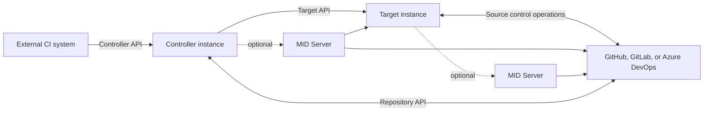
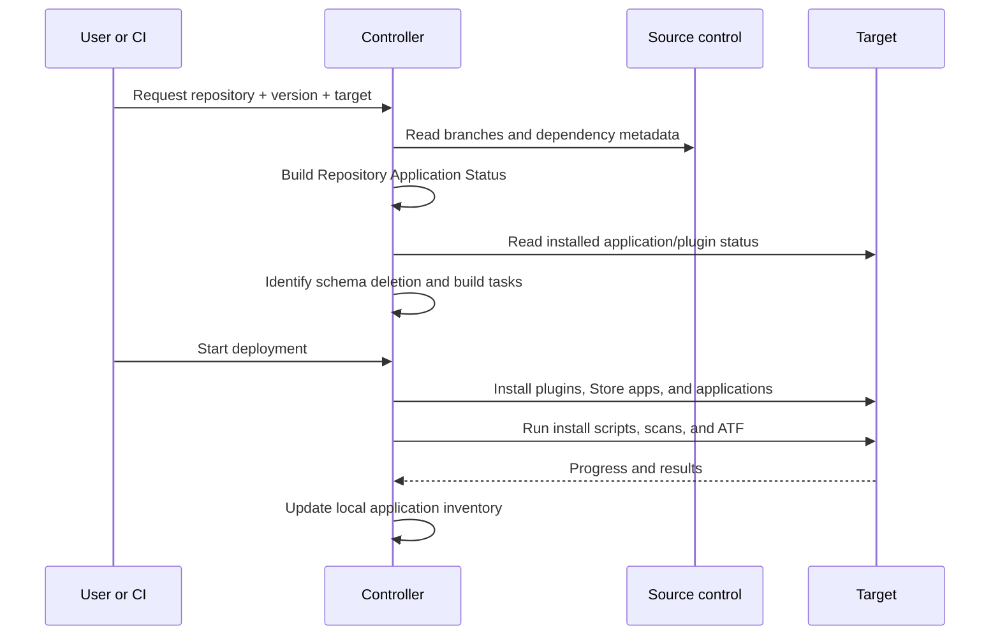

# Architecture

## Components and trust boundaries

The controller is the orchestration boundary. It stores target definitions, evaluates source-control metadata, creates deployment records, and calls the target. The target is the execution boundary: it performs operations against its own application records, ATF framework, and Instance Scan.

Repository access can be needed on both sides. The controller reads branches and application metadata to build the dependency tree. A target that imports an application for the first time also needs a matching Repository Credential mapping so it can perform the source-control import.

## Deployment flow

## Dependency ordering

Deployer reads the requested application's dependencies and recursively reads dependencies of dependencies. It consolidates minimum-version requirements and expects the exact requested version branches to be available.

Installation and validation work runs in reverse dependency order:

1. deepest dependency;
2. its dependants;
3. requested application last.

Installation scripts and default ATF suites follow the same reverse dependency order. This ensures that a component is available before software depending on it is installed or tested.

## Deployment plan

A Deployment is a Task-derived record. During **Prepare**, Deployer compares the requested dependency tree with the target's known state and creates ordered Deployment Task records. Tasks can be automatic or manual.

Automatic tasks cover plugin and Store app installation/update, custom application import/update, installation scripts, Instance Scan, and ATF. Manual tasks cover pre-deployment activities, data-deletion confirmation, smoke testing, and post-deployment activities.

## Local inventory

The controller keeps a local inventory of applications and versions discovered on target instances. The UI calls this the local CMDB. It is updated when:

- a Repository Application Status discovers versions available in source control;
- **Update Local CMDB** reads a target directly; and
- a deployment installs or updates applications.

Treat this inventory as a deployment aid, not as a replacement for authoritative enterprise CMDB governance.

## Repository Application Status modes

- **Deployment** validates an exact version and all compatible dependencies. It can be used to create a deployment.
- **Preview** evaluates a chosen branch, usually before baselining. It cannot create a deployment.
- **Checkout** evaluates the same branch across an application and its dependencies without strict dependency-version compatibility. It is intended for initializing or resetting a development instance.

See [Repository Application Status](repository-application-status.md) for procedures and failure modes.
