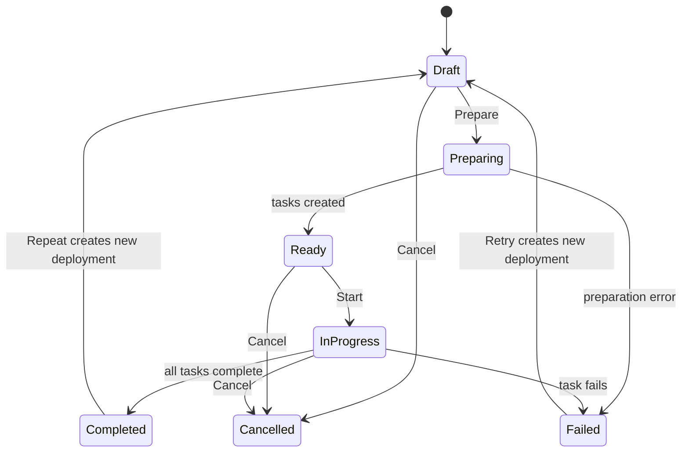

# Deployments

A Deployment binds a successful Repository Application Status to a Target Instance. Preparing the deployment turns that intent into an ordered list of automatic and manual tasks.

## Create and run a deployment

1. Open a RAS with status **Ready for Deployment**.
2. Select **Create Deployment**.
3. Choose the Target Instance and assignee.
4. Review deployment options:
   - **Enforce Refresh Applications** forces remote changes to be applied where appropriate.
   - **Enable Enforce Downgrade** exposes downgrade behavior; use it only for a deliberate rollback to an older version.
   - **Skip running CodeSanity checks** overrides the target default for this deployment.
   - **Skip running default ATF Test Suite** overrides the target default for this deployment.
5. Save the Draft deployment.
6. Select **Prepare**. Preparation runs asynchronously and creates deployment tasks.
7. Wait for state **Ready**.
8. Select **Show Task List** and review task order, automatic/manual execution, repository URLs, and versions.
9. Select **Start**.
10. Complete manual tasks when they become ready, and monitor automatic tasks.
11. When all work succeeds, confirm the Deployment reaches **Completed**.

Do not start until the generated task list matches the approved change.

## State model

Preparation and execution details appear in the deployment log and child task records.

## Task order

The exact list depends on target configuration and detected state. A typical plan is:

1. Pre-Deployment Activities — manual
2. Confirm Data Deletion — manual when policy is Confirm and deletions are detected
3. Plugin/Store app installation or update — automatic
4. Import, switch branch, or apply remote changes for custom applications — automatic, deepest dependency first
5. CodeSanity Instance Scan — automatic
6. Installation scripts — automatic, dependency first
7. Default ATF suites — automatic, dependency first
8. Smoke Test — manual
9. Post-Deployment Activities — manual

## Work a manual task

1. Open the ready Deployment Task.
2. Follow its Description and any target-specific instructions.
3. Record evidence in the task or linked change record as required by your process.
4. Select **Mark Task as Complete** to continue, or **Mark Task as Failed** to stop.

For data deletion, confirm the exact tables and columns before completing the task.

## Respond to a failed task

Use the least exceptional action that fits the situation:

- **Retry Task Execution** reruns a retryable automatic task and increments its retry count.
- **Mark Task as Failed** records failure for a manual task.
- **Skip Task** bypasses a task when the deployment policy permits it.
- **Ignore Failure** continues after a failed task; the overall deployment can only be marked failed afterward.
- **Cancel Task** stops Deployer's workflow progression. A remote operation already in flight may still finish.

Inspect the target before retrying. A timed-out source-control or installation request may have completed remotely even when the controller did not receive a successful response.

## Finish, retry, or repeat

- **Retry** creates a new deployment from a failed or cancelled deployment.
- **Repeat** creates a new deployment from a completed deployment with the same parameters.
- **Mark as Failed** closes a deployment that cannot safely continue.
- **Mark as Complete** is intended for exceptional reconciliation after work is verified; do not use it to hide failed or skipped controls.

The upstream metadata describes the **Mark as Complete** action inconsistently. Verify its behavior on a non-production instance before relying on it operationally.

## Rollback and downgrade

Deployer does not make application releases inherently reversible. Before forcing a downgrade:

- verify the older branch is compatible with current data and dependencies;
- identify schema elements introduced by the newer version;
- apply the target data-deletion policy;
- back up or export business data affected by schema changes;
- validate installation scripts for backward execution;
- use a fresh RAS and deployment record for auditability.

For a failed production change, follow the organization's incident and rollback procedure rather than improvising through task overrides.
